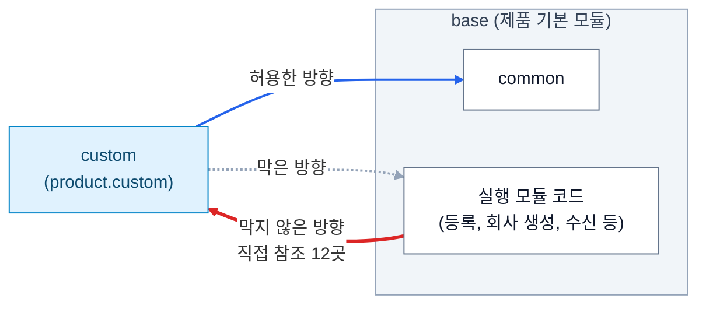
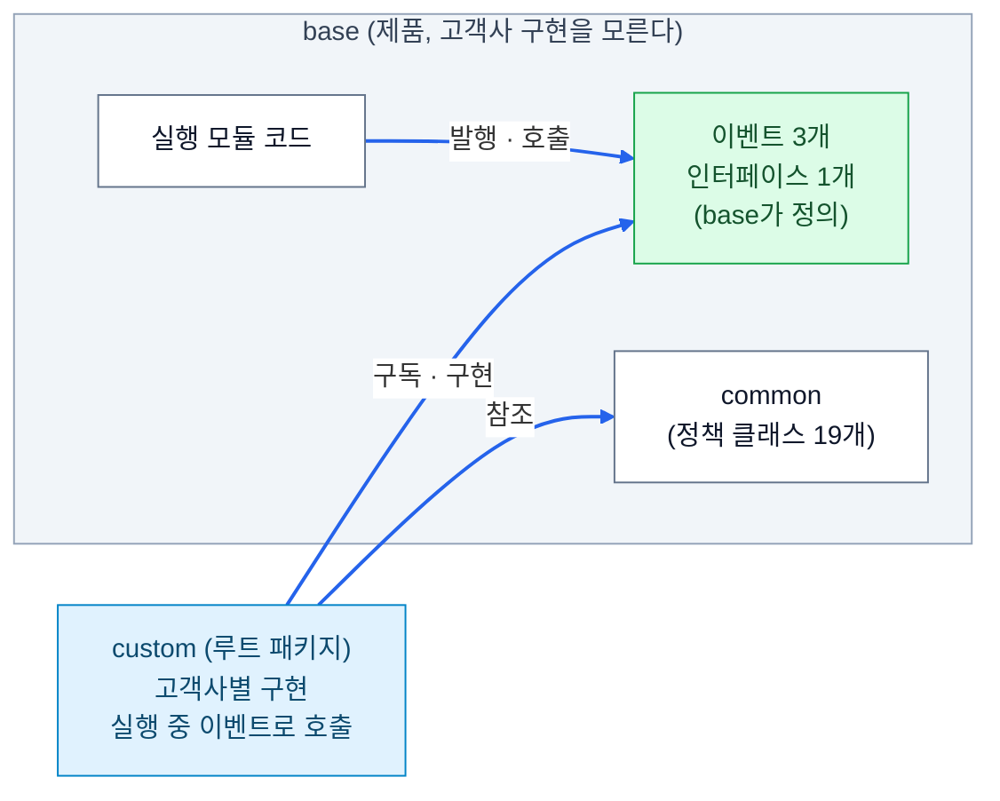

고객사마다 요구사항이 달라서, 그 차이를 따로 관리하는 커스터마이징 레이어가 있다. 이 레이어를 처음 설계한 사람이 나였다. 구현을 마치고 몇 달 뒤에 회사 표준안이 나왔고, 기존 코드를 새 구조에 맞춰 전면 수정해야 했다. 이 글에는 두 설계가 어떻게 달랐는지, 기존 구조에서 어떤 문제가 보였는지, 의존성을 어떻게 정리했는지 적는다. 패키지 이동과 빌드 검증은 다음 글에서 다룬다. 이하 커스터마이징 레이어는 `custom`, 제품의 기본 모듈은 `base`, 그 안의 공통 모듈은 `common`이라고 부른다. 실행 모듈은 사용자, 관리자, 배치, 외부 연동 앱 네 개다.

처음 세운 원칙은 단순했다. 커스터마이징 레이어는 common에만 의존한다. 다른 모듈의 기능이 필요하면 직접 참조하지 않고, 접두사를 붙인 클래스를 레이어 안에 따로 구현했다. 나중에 레이어를 분리하기 쉽게 하려는 의도였다. 패키지는 제품 패키지 하위인 `product.custom.{domain}`에 두었다. 제품과 패키지 루트를 공유하니 컴포넌트 스캔, AOP 포인트컷, 로깅 설정을 따로 고치지 않아도 커스터마이징 코드에 그대로 적용됐다. 구현하는 동안에는 문제가 드러나지 않았다.

문제는 의존성을 한쪽 방향으로만 제한했다는 것이다. 커스터마이징 레이어가 다른 제품 모듈을 참조하지 못하게 막았지만, 제품 코드가 커스터마이징 레이어를 참조하는 건 막지 않았다. 나중에 확인해 보니 base에서 커스터마이징 레이어를 직접 참조하는 곳이 12군데였다. 등록 서비스는 커스터마이징 서비스와 승인 게이트를 호출했고, 회사 생성 서비스는 고객사 초기화 로직을 실행했다. 외부 시스템 데이터를 수신하는 컨트롤러도 레이어의 데이터 보강 서비스를 직접 호출하고 있었다. 제품의 기본 동작이 고객사별 구현에 기대는 구조가 되어 있었다.



원인은 무엇을 독립적으로 유지해야 하는지 거꾸로 판단한 데 있었다. 나는 레이어를 제품에서 쉽게 떼어 내는 데 집중해서 레이어가 제품 모듈을 참조하지 못하게 했다. 그런데 회사 표준안에서 독립적으로 배포해야 하는 대상은 레이어가 아니라 제품이었다. 제품은 고객사별 구현 없이도 빌드할 수 있어야 하고, 레이어는 제품이 제공하는 기능을 가져다 고객사별 동작을 구현하는 쪽이다.

클린 아키텍처의 의존성 규칙으로 보면 이 판단이 왜 거꾸로였는지 설명된다. 소스 코드의 의존성은 안쪽 정책을 향해야 한다. 이 프로젝트에서는 제품의 기본 동작이 비교적 안정적인 안쪽이고, 고객사별 구현이 자주 바뀌는 바깥이다. 그러니 레이어가 제품의 공개된 기능을 참조하는 건 허용해도 되지만, 제품이 특정 고객사의 구현 클래스를 직접 알아서는 안 됐다. 나는 허용해도 되는 방향을 막고, 막아야 할 방향을 놓쳤다.

회사 표준안은 세 가지로 요약된다. 제품은 라이브러리 JAR로 배포하고, 고객사 작업에서는 제품의 기본 모듈을 수정하지 않고 별도 패키지에 커스터마이징을 구현하고, 최종 배포 때 제품 JAR과 커스터마이징 소스를 합쳐 실행 모듈별로 빌드한다. 기존 설계와 가장 크게 다른 건 패키지 위치였다. 기존에는 커스터마이징 코드를 제품 패키지 하위인 `product.custom`에 두었는데, 표준안은 제품 패키지와 별개인 루트 `custom` 패키지에 두라고 한다. 단순한 이동처럼 보여도 빌드 경계가 달라진다. 제품 JAR을 빌드할 때 루트 `custom`을 빼면 고객사별 구현이 산출물에 들어가지 않고, 이때 base에 레이어를 직접 참조하는 코드가 남아 있으면 제품 단독 빌드에서 컴파일 오류가 난다. 코드 리뷰와 개발자의 주의에 맡기던 규칙을 빌드가 검증해 주게 된 것이다.

또 하나는 실행 모듈별 분리다. 사용자, 관리자, 배치, 외부 연동 앱은 각각 독립된 Spring 애플리케이션이다. 커스터마이징 패키지를 하나로 합치면 컴포넌트 스캔 범위에 따라 다른 실행 모듈의 빈까지 등록될 수 있다. 관리자 전용 컨트롤러가 사용자 서버에 올라오는 경우가 그렇다. 그래서 표준안은 실행 모듈마다 커스터마이징 영역을 따로 두게 한다.

새 구조를 적용하려면 base에서 레이어를 참조하는 12군데를 모두 정리해야 했다. 처음에는 참조마다 인터페이스를 정의하고 레이어에서 구현하게 바꿀 생각이었는데, 모든 참조에 확장점이 필요한 건 아니었다. 그래서 먼저 각 기능을 분류했다. 기준은 고객사가 이 동작을 화면 설정으로 바꾸는지, 코드를 고쳐서 바꾸는지였다.

화면에서 설정하는 정책은 common으로 옮겼다. 코드 원장, 조회 권한, 표시 유형, 통계 유틸리티, 기준값 관련 기능은 고객사마다 설정이 달라도 코드를 고쳐 동작을 갈아 끼우는 기능은 아니었다. 확장점을 만들 이유가 없어서 클래스를 common으로 이동했고, 딸린 의존성까지 따라가니 대상이 19개였다. 기존 참조 코드의 변경을 줄이려고 클래스 이름과 패키지 경로는 그대로 두었다. 그 결과 이름에는 `custom`이 들어 있지만 실제로는 제품 코드인 클래스가 생겼다. 구분은 소스 위치와 빌드 포함 여부로 한다. 루트 `custom` 아래는 고객사별 구현이고 `product.custom` 아래는 제품에 들어가는 공통 코드다. 이름만 보면 헷갈리지만, 참조를 대량으로 고치는 것보다 빌드 경계를 먼저 정리하는 쪽을 택했다.

고객사에 따라 구현이 달라질 수 있는 기능은 이벤트로 분리했다. 특정 코드를 저장하기 전 검증, 회사 생성 시 초기화, 외부 시스템 수신 데이터 보강이 대상이다. 기존에는 base가 레이어의 서비스를 직접 호출했는데, 바꾼 뒤에는 base가 특정 시점에 이벤트를 발행하고 레이어가 그 이벤트를 구독해 동작을 수행한다.

```java
// base: 확장 시점만 알린다.
applicationEventPublisher.publishEvent(
    new BeforeSaveEvent(companyId, code)
);

// custom: 고객사별 검증을 수행한다.
@EventListener
public void on(BeforeSaveEvent event) {
    guardService.assertAllowed(
        event.companyId(),
        event.code()
    );
}
```

base는 고객사별 검증 서비스가 있는지 몰라도 되고 이벤트 타입만 알면 된다. 레이어는 base가 정의한 이벤트를 참조해 동작을 구현한다. 실행 중에는 이벤트로 레이어의 코드가 호출되지만, 소스 코드 수준에서 base는 레이어에 의존하지 않는다. 컴파일 타임 의존성이 이벤트로 끊어진 것이다.

비동기 이벤트는 쓰지 않았다. 기존 직접 호출처럼 저장 전 검증이 끝나야 다음 로직으로 넘어갈 수 있었기 때문이다. Spring의 기본 동기 `@EventListener`는 발행한 스레드에서 리스너가 실행되어서, 리스너가 던진 예외가 발행 지점까지 전파되고 저장이 중단되는 기존 동작이 유지된다. 이벤트를 발행하는 위치와 트랜잭션 경계도 예전 호출 방식에 맞췄다.

모든 동작을 이벤트로 처리할 수는 없었다. 초과분 중 실적으로 인정할 양을 정하는 승인 게이트는 계산 결과를 호출한 쪽에 돌려줘야 한다. 이 경우에는 base에 인터페이스를 정의하고 레이어에서 구현하게 했다. 제품은 고객사 구현 클래스가 아니라 추상화된 계약에 의존하니, 의존성 역전 원칙을 적용한 셈이다.

```java
Optional<GrantedAmountResolver> resolver;   // 주입
int granted = resolver.map(r -> r.resolve(...))
                      .orElse(Math.max(0, calculated));   // 없으면 계산값 그대로
```

다만 주의할 점이 있었다. 고객사 사이트에 이 구현 빈이 등록되지 않으면 위 코드의 `orElse`로 빠져서 미승인 초과분이 검증 없이 계산값 그대로 실적에 반영된다. 컴파일은 되는데 실행 환경에서 구현이 빠질 수 있다는 뜻이어서, 이 빈의 등록 여부를 고객사 인수 때 확인할 항목에 넣었다.

최종적으로 base에 추가한 확장점은 이벤트 세 개와 인터페이스 하나였다. 처음 생각대로 역참조마다 인터페이스를 만들었다면 확장점이 훨씬 늘었을 것이다. 확장점이 하나 늘 때마다 제품과 고객사 구현 사이에 지켜야 할 계약도 하나씩 늘고, 바뀔 일이 없는 기능까지 인터페이스로 빼면 구조만 복잡해진다. 그래서 고객사별 구현이 실제로 필요한 곳에만 두었다.



이번 작업을 클린 아키텍처를 적용한 사례라고 하기는 어렵다. 엔티티와 유스케이스를 중심으로 계층을 다시 나눈 게 아니라 제품 코드와 고객사별 구현 사이의 의존성 방향을 정리한 작업이기 때문이다. 의존성 규칙은 코드를 짜는 입장에서는 레이어가 제품을 어디까지 부를 수 있는지 정하는 규칙으로 보였는데, 제품을 내보내는 입장에서 보니 제품이 고객사 코드를 모르는 쪽이 먼저였다. 제품은 고객사별 구현을 모르고, 고객사별 구현은 제품이 제공하는 계약을 안다. 다음 글에서는 패키지를 실제로 옮기면서 생긴 문제와 모듈별 빌드 검증을 다룬다.