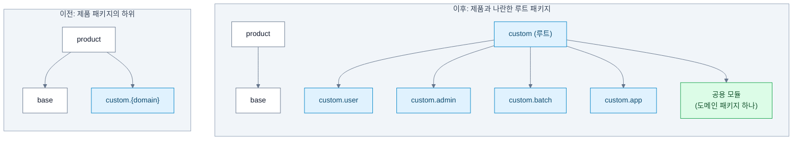
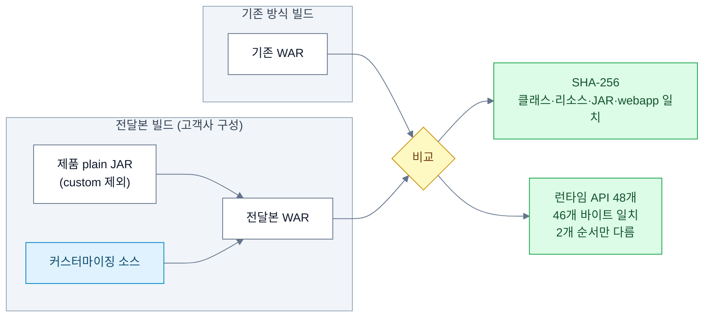

앞 글에서는 base가 커스터마이징 레이어를 직접 참조하던 12군데를 끊어서 의존 방향을 바로잡았다. 이번에는 그 방향을 코드 위치와 빌드에 실제로 새기는 과정을 적는다. 파일을 옮기고, 기존 패키지 구조 덕분에 별도 설정 없이 적용되던 기능을 다시 연결하고, 변경 전후의 결과가 같은지 검증했다. 용어는 앞 글과 같다. 커스터마이징 레이어는 `custom`, 제품의 기본 모듈은 `base`, 그 안의 공통 모듈은 `common`이다. 실행 모듈은 사용자, 관리자, 배치, 외부 연동 앱 네 개다.

경계가 말로만 있으면 지켜지지 않는다는 건 첫 설계에서 이미 겪었다. 레이어는 제품에 기대지 않는다는 원칙은 있었지만, 패키지가 제품 밑에 있으니 그 경계는 이름 규칙에 불과했다. `custom`을 제품 패키지와 나란한 루트로 옮기면 경계가 소스 구조와 빌드에 들어간다. 이동 대상은 한 업무 도메인의 커스터마이징 코드 전체인 315개 파일이었다. 파일 이동, `package` 선언, FQCN, 같은 패키지 안의 참조는 스크립트로 일괄 변경했지만 자동 변경만으로 끝나지는 않았다. Java 코드의 참조 208곳은 직접 고쳐야 했고, 매퍼 XML은 `namespace`뿐 아니라 `resultType`, `parameterType`에 선언된 FQCN까지 바꿔야 해서 46개 파일 123곳 이상이었다.

수정한 코드는 기존 내용을 주석으로 남겨야 한다는 팀 규칙이 있어서, 파일을 옮기면서도 변경 전 코드를 주석으로 보존했다. 문제는 XML에서 났다. 변경 이전 코드를 보존한 주석 안에도 옛 FQCN이 남아 있었고, 이를 고치려고 기존 주석을 다시 주석으로 감싸면서 중첩 주석이 만들어졌다. XML은 주석 중첩을 허용하지 않아서 파싱 오류가 났고, 배치 테스트 116건과 외부 연동 앱 테스트 618건이 애플리케이션 컨텍스트를 초기화하는 단계에서 모두 실패했다. 그 뒤로는 기존 주석 블록 안을 변경 대상에서 제외했고, 망가진 XML 15개는 원본을 기준으로 다시 만들었다.

패키지를 옮긴 뒤에는 기존 구조 덕분에 별도 설정 없이 적용되던 기능을 다시 연결해야 했다. 이때 가장 주의한 건 오류 없이 동작이 달라지는 경우다. base 곳곳에는 특정 패키지에 속한 클래스를 판별하려고 `.startsWith("product")` 같은 문자열 비교를 쓰는 코드가 있었다. 커스터마이징 코드를 루트 `custom`으로 옮기면 Spring 빈은 정상 등록되는데 이 조건에서는 빠진다. 컴파일 오류도 실행 오류도 나지 않고, 해당 기능만 적용되지 않는다. 응답 봉투가 안 씌워지거나, 타임존 변환이 누락되거나, 캐시 어노테이션이 동작하지 않거나, 에러 로그 분류가 달라질 수 있었다.

클린 아키텍처로 보면 안쪽에 있는 base가 바깥 코드를 import하지는 않았지만, 바깥 코드가 어느 패키지에 있는지는 문자열로 알고 있었던 것이다. 컴파일러가 확인할 수 없는 형태의 의존이다. 이런 문자열 비교와 포인트컷이 9곳이었다. 판별 로직은 상수 클래스 한 곳에 모았고, 단순 접두사 비교 대신 패키지 경계를 기준으로 판별해서 `customxyz`처럼 이름만 비슷한 패키지가 걸리지 않게 했다. 없앨 수 없는 지식이라면 흩어 두지 않고 한 곳에 모아 두는 쪽을 택했다.

Spring 스캔 설정도 바꿔야 했다. 각 실행 모듈의 `@ComponentScan`, `@EntityScan`, `@MapperScan`, `@EnableJpaRepositories`에 커스터마이징 패키지를 추가했는데, 진입 클래스마다 설정을 흩어 두지 않고 모듈별 설정 클래스 하나에 모아서 제품 코드의 수정 범위를 줄였다. 어떤 고객사 구현을 끌어다 조립할지는 실행 모듈이 정하고 base는 그 사실을 모른다. 클린 아키텍처에서 말하는 main 컴포넌트, 곧 구현을 조립하는 자리와 비슷하다. 여기서도 예상 못 한 문제가 있었다. `@MapperScan`의 `*` 패턴은 경로 한 단계만 매칭해서 `custom.*.mapper`로는 `custom.user.biz.mapper`의 매퍼를 찾지 못했다. 배치 모듈은 특정 도메인의 마스터 빈이 등록되면 안 돼서 필요한 패키지만 명시적으로 스캔하게 했다.

회사 표준안을 그대로 적용하지 않은 부분도 있다. 표준안은 실행 모듈마다 커스터마이징 코드를 따로 구성하라고 하지만, 여러 모듈이 같은 계산 로직을 쓰면 같은 코드가 모듈 수만큼 복제된다. 고객사는 전달받은 소스를 직접 수정하는데, 한 모듈의 코드만 고치고 나머지를 그대로 빌드하면 컴파일 오류 없이 모듈끼리 계산 결과가 달라질 수 있다. 이 코드들은 같은 이유로 바뀌고 같이 바뀌어야 하니, 중복으로 두는 것보다 한곳에 모으는 편이 맞다고 봤다. 표준 문서도 공통 기능에는 예외를 허용하고 있었다. 그래서 여러 실행 모듈이 쓰는 계산 로직은 공용 모듈에 한 번만 구현하고 도메인 패키지도 하나로 유지했다. 대신 공용 모듈에 컨트롤러, 잡, 스케줄러를 두지 못하게 아키텍처 테스트를 추가했다. 요청을 받거나 실행 시점을 정하는 진입점은 바깥쪽인 각 실행 모듈에 두고, 공용 모듈에는 공유하는 계산 로직만 남겼다. 앞 글에서는 컴파일러가 의존 방향을 지켜 줬고, 여기서는 테스트가 구조 규칙을 지킨다.

리팩터링을 마친 뒤 가장 신경 쓴 건 고객사에 전달하는 구성으로 빌드했을 때 기존 산출물과 차이가 없는지 확인하는 일이었다. 경계를 바로잡는 작업은 동작을 바꾸면 안 된다. 제품 소스 없이 plain JAR과 커스터마이징 소스만으로 WAR를 빌드해서 기존 방식으로 만든 WAR와 비교했다. 클래스와 리소스, 서드파티 JAR, `webapp` 파일을 SHA-256 해시로 비교했고, 사용자 3,958개, 관리자 5,358개, 배치 2,267개, 외부 연동 앱 4,741개의 클래스·리소스가 모두 일치했다. 차이가 나온 파일은 없었다.

런타임 동작도 확인했다. 사용자, 관리자, 외부 연동 앱 모듈을 기존 WAR와 전달본 WAR로 각각 띄우고, 같은 토큰으로 조회 API 48개를 호출해 응답을 비교했다. 46개는 바이트 단위까지 일치했고, 나머지 2개는 응답 데이터의 순서만 달랐다. 원인은 `Set.of`로 만든 집합의 순회 순서가 JVM을 띄울 때마다 달라질 수 있는 기존 동작이었다. 두 빌드의 클래스 바이트가 같고 순서 차이도 기존 구현에서 생기는 동작이라서 이번 리팩터링 때문은 아니라고 판단했다. 다만 이 검증은 비교한 파일과 API가 같다는 걸 확인한 것이고, 모든 실행 경로의 동작이 같다는 보장은 아니다.

검증하면서 빌드 설정에 관한 조건도 두 가지 알게 됐다. 하나는 공용 모듈의 컴파일 옵션이다. 이 프로젝트에서는 Spring Boot 플러그인을 적용했는지에 따라 Java 컴파일 때 `-parameters` 옵션이 달라졌다. 이 옵션이 빠지면 공용 클래스 241개에서 `MethodParameters` 메타데이터가 사라졌다. 소스가 같아도 컴파일 옵션에 따라 클래스 파일이 달라질 수 있어서, 공용 모듈에도 기존과 같은 옵션이 적용되게 했다. 다른 하나는 전달할 라이브러리를 뽑는 기준이다. `runtimeClasspath`로 뽑으면 개발 전용 라이브러리까지 들어가고, 이를 손으로 걸러 내면 실행에 필요한 공용 라이브러리까지 빠질 수 있었다. 기존 배포 구성과 일치한 건 `productionRuntimeClasspath`였다. 두 가지 다 의존성 규칙으로는 설명되지 않는다. 경계를 제대로 나눠도 빌드 설정 하나가 어긋나면 결과가 달라졌고, 그건 두 빌드를 비교해 보기 전에는 보이지 않았다.

Liquibase changelog는 이동 대상에서 제외했다. Liquibase는 changeset의 `id`, `author`, 파일 경로로 적용 이력을 식별해서, 경로가 달라지면 이미 실행된 changeset도 새 변경으로 인식될 수 있다. 이미 적용된 changeset이 179개였다. 그래서 changelog 파일은 기존 위치에 두고, 고객사별 변경을 연결하는 진입 changelog만 공용 모듈에 추가해 `base`에서 `include`하게 했다.

마지막으로 남은 문제는 이후 개발 코드와의 병합이었다. 리팩터링이 끝나도 다른 개발자가 기존 패키지명을 기준으로 코드를 추가할 수 있다. 특히 XML이나 설정 파일에 문자열로 적힌 FQCN은 컴파일에서 발견되지 않고, 그 기능을 실행하는 테스트가 없으면 놓칠 수도 있다. 그래서 dev 브랜치를 병합할 때마다 기존 패키지명이 유효한 코드나 설정에 남아 있는지 `grep`으로 확인하기로 했다. 이번 작업에서 파일을 옮기는 일 자체는 가장 어려운 부분이 아니었다. 기존 패키지 구조를 전제로 동작하던 설정과 문자열 기반 의존을 찾아내고, 고객사 전달 구성에서도 같은 결과가 나오는지 확인하는 데 시간이 더 들었다.
